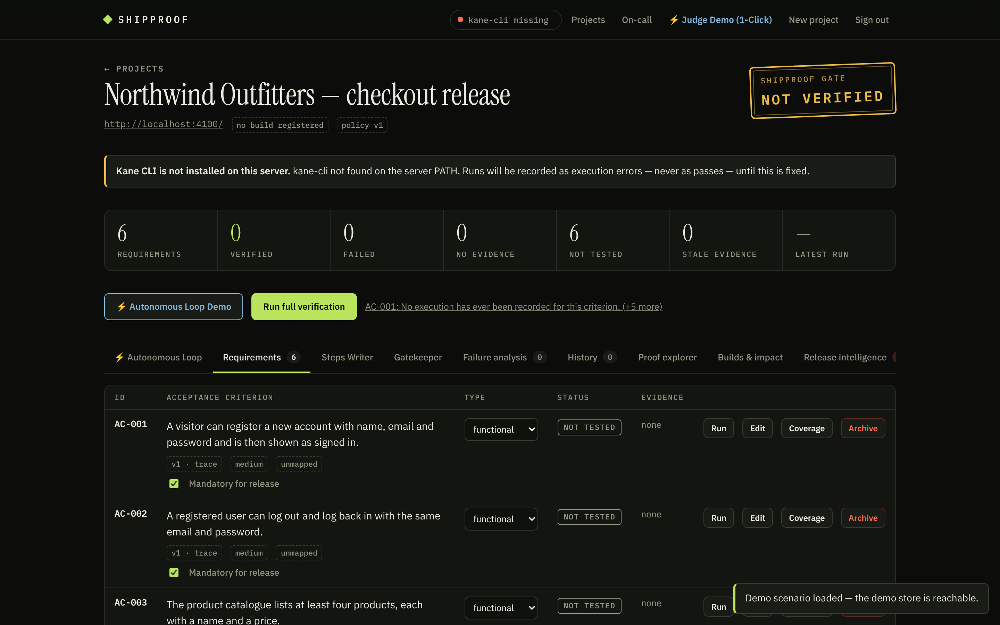
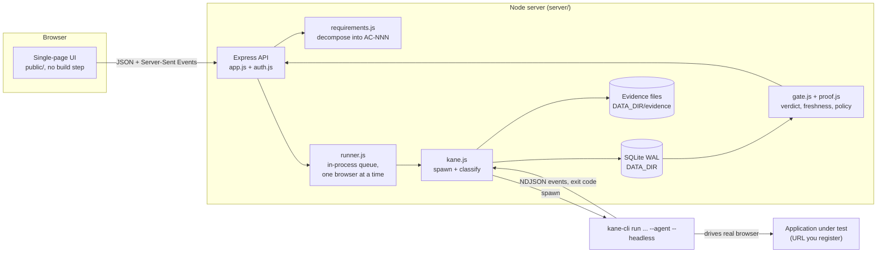
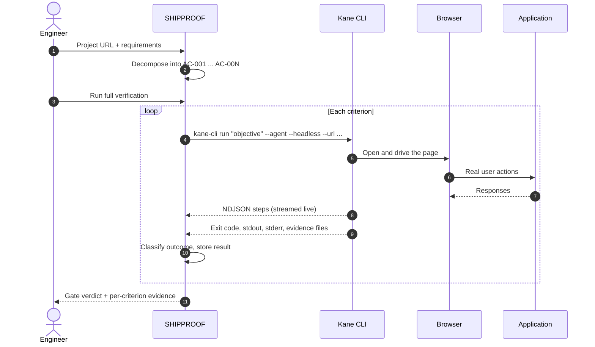
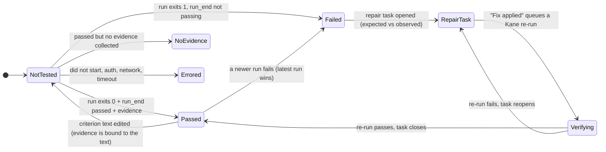
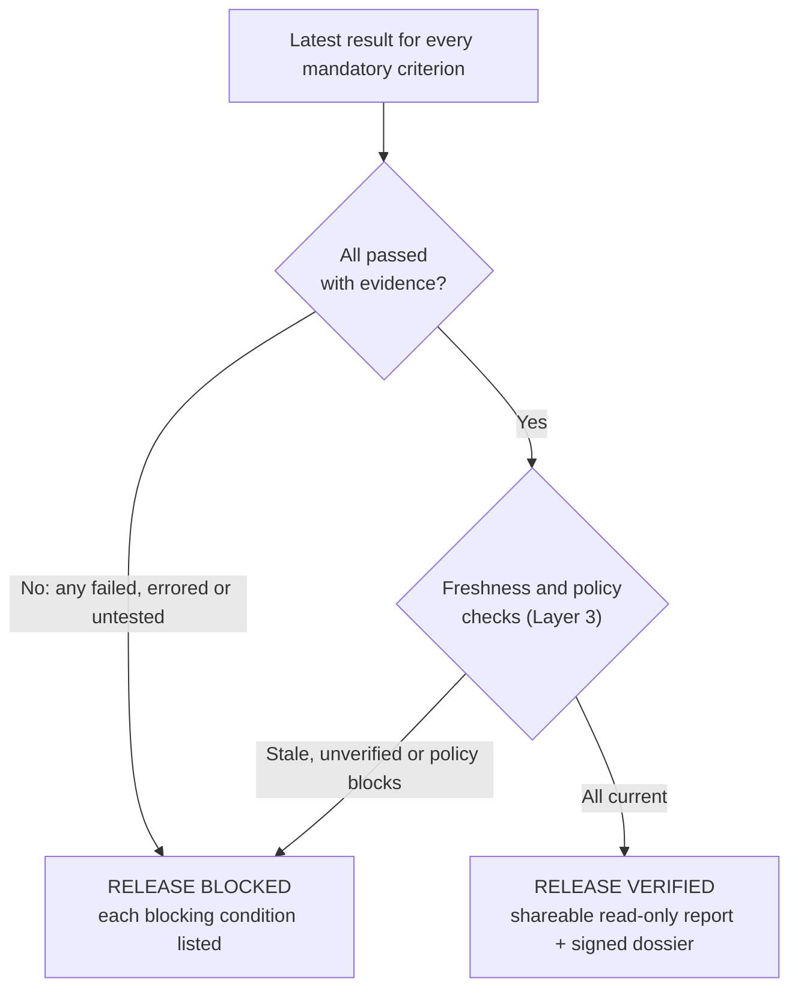
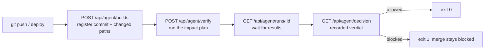

<div align="center">

# SHIPPROOF

**Don't trust what your coding agent says. Verify what it ships.**

Evidence-backed release verification for AI-generated software, powered by [Kane CLI](https://www.testmuai.com/docs/kane-cli-introduction).

[Quick start](#quick-start) · [How it works](#how-it-works) · [Gate rules](#gate-rules) · [Demo](#demo-walkthrough) · [Algorithm intelligence](#algorithm-intelligence) · [API](#apis) · [Docs](#documentation)

</div>

---

SHIPPROOF takes a live application URL and requirements written in plain language. It splits the requirements
into atomic acceptance criteria, runs each one in a real browser through Kane CLI, stores what actually happened,
turns each failure into a repair task, re-verifies the fix, and only then signs the release.

The core rule is simple: **nothing in SHIPPROOF can mark a criterion as verified except a `kane-cli run` that
exits `0` with a passing `run_end` event.** There is no manual override.

## Contents

- [Screens](#screens)
- [How it works](#how-it-works)
- [Gate rules](#gate-rules)
- [Quick start](#quick-start)
- [Demo walkthrough](#demo-walkthrough)
- [Proof intelligence](#proof-intelligence)
- [On-call engineer (voice)](#on-call-engineer-voice)
- [Algorithm intelligence](#algorithm-intelligence)
- [APIs](#apis)
- [Tests](#tests)
- [Security](#security)
- [Documentation](#documentation)

## Screens

<table>
<tr>
<td width="50%" valign="top">

**Landing page.** The gate rules the server enforces, stated up front.


</td>
<td width="50%" valign="top">

**Workspace.** Projects, and a banner that states whether Kane CLI is installed and signed in.


</td>
</tr>
<tr>
<td width="50%" valign="top">

**Requirements to criteria.** Plain-language requirements become `AC-001`… with a type each, before anything runs.


</td>
<td width="50%" valign="top">

**Release gate.** A new project starts as **NOT VERIFIED**. Every criterion shows its status and evidence, and each has its own Run action.



</td>
</tr>
</table>

> The screenshots come from a fresh install on a machine without Kane CLI. The banner on the dashboard and
> project page says so, and runs are recorded as errors, never as passes. Screenshots of executed runs,
> evidence and the release report need Kane CLI signed in; see [Quick start](#quick-start).

## How it works

### Architecture



### One verification, end to end



### What happens to a failure



### Release decision



The gate is strict on purpose. A pass that was produced against an older version of a criterion, or
against a build whose changed files affect it, does not count.

### Why each part exists

| Part | Responsibility | Where |
|---|---|---|
| Requirement decomposition | Turns sentences into criteria with stable IDs, typed `functional`, `visual` or `persistence` | `server/requirements.js` |
| Kane runner | Spawns Kane CLI once per criterion, streams events, classifies the outcome | `server/kane.js`, `server/runner.js` |
| Gate | Computes criterion status and the release verdict from stored results on every request | `server/gate.js` |
| Proof engine | Criterion versions, build impact, freshness, stability, policy, signed dossiers | `server/proof.js` |
| Repair loop | Turns failures into prompts for a coding agent and re-runs only what was fixed | `server/app.js`, `server/coding-agent.js` |
| Continuous watch | Scheduled health checks of the verification system itself | `server/watch.js` |
| Algorithm intelligence | Test selection, fault localization, exploration, reduction, package fingerprints, transparency log | `server/impact-graph.js`, `server/fault-localization.js`, `server/transparency.js`, `playtest-agent-main/pt/`, `gatekeeper-main/src/gatekeeper/fingerprint/` |

Nothing on screen is stored as a status flag. Totals, criterion status and the verdict are recomputed from
the `results` table, so the UI cannot drift from the evidence.

## Gate rules

Enforced in `server/kane.js` and `server/gate.js`.

**What counts as a pass.** Exit code `0`, **and** a `run_end` event, **and** a passing status, **and** at least
one collected evidence artifact. Anything else is not a pass.

**What counts as no evidence.** Each of these is its own state, shown separately:

| Observation | Result |
|---|---|
| Kane CLI missing, not authenticated, or a network error | `error` (unverified) |
| Did not start, timed out, interrupted by a restart | `error` / `timeout` (unverified) |
| Exit code and `run_end` status disagree | `error / inconsistent` |
| Passing run with no evidence artifact | `error / no_evidence` |
| Target URL refused by the target policy | `error / target_blocked` |
| User cancelled | `cancelled`, ignored by the gate |

**Rules that follow from this:**

- The latest execution wins. A newer failure replaces an older pass.
- A failed mandatory criterion **blocks the release**.
- Evidence is bound to the criterion's text. Edit the text and the criterion returns to *not tested*.
- A criterion with an open failure cannot be reworded, made optional or archived.
- There is no "mark as passed" button.

## Quick start

**Requirements:** Node.js 22.5 or later, and Chrome or Chromium on the machine that runs the server.

```bash
npm install
```

```bash
npm install -g @testmuai/kane-cli
```

Sign in to Kane CLI once on the host. For servers and CI, skip this and set `LT_USERNAME` and `LT_ACCESS_KEY` instead (see below).

```bash
kane-cli login
```

```bash
cp .env.example .env
```

```bash
npm start
```

Open <http://localhost:4000>. The pill in the top bar shows the installed Kane CLI version and whether it is
signed in.

- The SQLite database and evidence files live in `DATA_DIR` (default `./data`).
- Migrations in `migrations/` run automatically on start. `npm run migrate` applies them on their own.
- For servers and CI, set `LT_USERNAME` and `LT_ACCESS_KEY` in the environment. They are passed to Kane CLI only
  and redacted from every stored log and API response.

### Docker

```bash
docker build -t shipproof .
```

```bash
docker run -p 4000:4000 -v shipproof-data:/data -e LT_USERNAME=... -e LT_ACCESS_KEY=... shipproof
```

Or with Compose (named volume, health check, graceful stop):

```bash
docker compose up -d --build
```

Deploy it anywhere that runs a long-lived container with Chrome: Fly.io, Render, Railway or a VM.
Serverless platforms are not suitable, because the engine spawns browser processes that run for minutes.
Production checklist, backup and restore, and rollback are in [docs/DEPLOYMENT.md](docs/DEPLOYMENT.md).

## Demo walkthrough

The repository ships a sample store, **Northwind Outfitters** (`demo-app/`): registration, login, product
catalogue, cart, coupon, checkout confirmation and order history. It has one real bug: coupon `SAVE10` is
accepted and the discount line is shown, but the order total does not change (`demo-app/pricing.js`). The
unit test for the discount maths passes anyway, which is exactly the gap SHIPPROOF is built to catch.

The demo store runs on `localhost`, so the server must allow private targets. `ALLOW_PRIVATE_TARGETS=1` is set in
`.env.example`; copy it to `.env`.

Terminal 1:

```bash
npm start
```

Terminal 2 (restarts automatically when the code changes):

```bash
npm run demo:app
```

| Time | Step |
|---|---|
| 0:00 | Sign up. The landing page states the gate rules. |
| 0:20 | **New verification project → Load demo scenario**. The URL and six requirements fill in and preview as `AC-001…AC-006`. |
| 0:40 | **Run full verification**. The live view streams Kane CLI's NDJSON steps as the browser registers, logs in, browses and adds to cart. |
| 1:20 | `AC-005` fails: the total shows $80.00 where $72.00 is expected. The gate reads **RELEASE BLOCKED**. Open the check for the failing step, screenshots, stdout, stderr and exit code. |
| 1:45 | **Failure analysis** → repair task `RT-1` with expected vs observed, evidence, and **Copy repair task** (a prompt for a coding agent). Editing `AC-005` is refused. |
| 2:05 | Apply the real fix: `npm run demo:fix`, a one-line patch to `pricing.js`. The store reloads. |
| 2:15 | **Fix applied → re-verify**. Kane CLI re-runs `AC-005` and it passes. `RT-1` closes and links to the passing run. |
| 2:35 | **Release report**: **RELEASE VERIFIED**, execution trail per criterion (red, then green for `AC-005`), both runs in history. Create a shareable link and open it signed out. |

Apply the fix and reset the store to the buggy build for another take:

```bash
npm run demo:fix
```

```bash
npm run demo:break
```

## Proof intelligence

SHIPPROOF tracks *which version* of the application each piece of evidence verified.

- **Proof graph.** Project → build → requirement → criterion version → execution → events → evidence →
  repair task → verifying run → release decision, as linked rows. Editing a criterion appends an immutable version,
  and each execution keeps pointing at the version it ran. Browse it in **Proof explorer**: search by key, text,
  area, path, commit SHA, run number or evidence hash.
- **Builds and change impact.** A build is a commit plus an environment, registered by CI, a GitHub push
  webhook or the UI. Each criterion can declare criticality, functional areas and source-path patterns
  (`**`, `*`, `?`). For a build, every criterion is reported as *affected*, *unaffected* or *unknown*, with a
  verification plan that gives a reason per criterion. The graph-based selection described in
  [Algorithm intelligence](#algorithm-intelligence) extends this with indirect dependencies.
- **Freshness.** Evidence is `CURRENT`, `STALE`, `UNVERIFIED`, `FAILED` or `BLOCKED`. A pass goes stale when a
  later build changes mapped files, when impact cannot be established, or when environment, engine-version or
  policy rules say so.
- **Stability.** Classified from passed and failed outcomes of the current text only: `stable_pass`,
  `stable_fail`, `intermittent`, or `insufficient_data` below the minimum sample (default 5). Auth, network,
  timeout and interruption results are counted separately and excluded.
- **Risk.** An ordinal ranking built from listed factors (criticality, evidence state, stability, coverage gaps).
  It is not a probability and never changes a verdict.
- **Release policy.** Versioned per project. The decision is the strict gate **and** the policy. It lists each
  blocking condition with a code, the run it refers to, and the action that resolves it. No policy setting can
  make a failed or unexecuted mandatory criterion pass.
- **Proof dossier.** Canonical JSON with criterion versions, supporting executions, engine identity, evidence
  SHA-256 hashes, repair history and the decision, signed with a server-held Ed25519 key. Verify offline:

```bash
node scripts/verify-dossier.mjs shipproof-dossier-<id>.json --trust-key <keyId>
```

### GitHub CI

1. Project → **Settings** → generate an API key. Add it to the repository as the secret `SHIPPROOF_API_KEY`,
   and add the variable `SHIPPROOF_URL`.
2. Copy the workflow from Project → **CI** (served at `/ci/shipproof-verify.yml`) into `.github/workflows/`.
   Make it run after your deploy job.
3. Optional: Project → **CI** → create a webhook secret, then add a GitHub webhook (push events, JSON) so every
   push registers a build.

The job runs `/ci/shipproof-ci.mjs`: register the build, run the impact plan, wait for the run, fetch the
decision, and exit `0` only if the release is allowed.



## On-call engineer (voice)

Call an engineering agent from the browser and describe an incident. It investigates the systems it has access to,
fixes the defect on an isolated branch, proves the fix with a red/green regression test, pushes the branch and
opens a pull request. Every step is recorded as evidence, and production actions are gated on an on-screen
approval. Setup, the safety model and limits are in [docs/ONCALL.md](docs/ONCALL.md).

## Algorithm intelligence

This section documents the algorithm layer added to SHIPPROOF: what each piece does, how to use it, what it was
measured against, and what it does **not** do. Every number here comes from a file in
[`benchmarks/algorithm-intelligence/`](benchmarks/algorithm-intelligence/), and the full write-up is in
[ALGORITHM_BENCHMARK_REPORT.md](ALGORITHM_BENCHMARK_REPORT.md).

**The rule that still holds.** None of these components can turn a non-passing criterion into a pass, change a
criterion's verification state, or override the release gate. Selection decides *what to run*. Localization,
exploration and reduction produce *leads to investigate*. Fingerprints and transparency produce *evidence about
relationships and history*. A model's or an algorithm's opinion is never a verified result.

### At a glance

| Feature | Question it answers | Shipped in product | Measured result, in brief |
|---|---|---|---|
| Test impact selection | Which criteria must run for this commit, and why? | Yes: API endpoint | Full recall without a budget, but runs everything in this repo; budgets cut recall sharply |
| Ochiai fault localization | Which components are statistically associated with failures? | Library only | Did not localize seeded defects on file-level spectra; worse than random |
| NSGA-II exploration | Can a search over browser action sequences find more states and defects? | Library and synthetic model | Did not beat random sampling on the synthetic model |
| ProbDD-style reduction | Can a failing interaction be shrunk with fewer replays? | Library | 21% fewer replays than the existing reducer, same final length |
| MinHash / LSH fingerprints | Which package sources share code, even after renaming? | Library (Gatekeeper) | Recall 0.92 at threshold 0.5; no false pairs on boilerplate negatives |
| Merkle transparency log | Can a verifier check the evidence history was not rewritten? | Library | Correct on every small tree tested; no scale benchmark |

### 1. Test impact selection

**What it does.** For one commit, it decides which acceptance criteria can be affected by the changed files, using
an import graph built from the commit's JavaScript and TypeScript sources. It explains each decision with a path, for
example `server/db.js → server/gate.js → server/app.js`.

**How it decides.**

1. The graph is built from the sources you send: every relative `import`, `export … from`, `require(...)` and literal
   `import(...)` becomes an edge. Strings and comments are masked first, so a template that *contains* the text
   `require(...)` is not treated as a dependency.
2. The changed files are walked backwards through the graph (reverse breadth-first search), so every file that
   depends on a change is found, with the chain that reaches it.
3. Each criterion is classified:

   | Tier | Meaning | Runs? |
   |---|---|---|
   | `direct` | A changed file matches the criterion's mapped paths | Yes |
   | `transitive` | A file that depends on a change matches the mapped paths | Yes if required; otherwise admitted within the budget |
   | `mandatory` | Mandatory, critical or security criterion with no matching change | Always |
   | `unknown` | Unmapped criterion, or impact cannot be established | Always |
   | `excluded` | No changed file and no dependent file matches | No, with the reason stated |

4. Optional transitive criteria are admitted in a fixed order (shortest chain, then highest historical failure rate,
   then lowest cost) until the budget is spent. Required criteria are never dropped; if they alone exceed the
   budget, the plan says `overBudget: true`.

**Full fallback to running everything** when: the change set of the build is unknown (no changed paths were
registered), a build-level file changed (`package.json`, `package-lock.json`, `pyproject.toml`, `uv.lock`,
`Dockerfile`, `docker-compose.yml`, `.github/**`, `migrations/**`), or the plan reports `fallback` with a reason.

**Unknown is never unaffected.** A changed file with no dependency information (for example a stylesheet or an
HTML template) cannot exclude a criterion whose mapping does not match it, so such criteria run. A file with a load the
graph cannot resolve (a computed `require(name)`) marks the whole graph as incomplete, and unmatched criteria run.

**Endpoint.** `POST /api/projects/:pid/builds/:bid/selection`, signed-in owner only. It executes nothing.

```bash
curl -s -X POST "$SHIPPROOF_URL/api/projects/$PID/builds/$BID/selection" \
  -H "Cookie: $SESSION_COOKIE" -H "Content-Type: application/json" \
  -d '{
        "sources": {
          "server/db.js": "export const now = () => new Date().toISOString();\n",
          "server/gate.js": "import { now } from \"./db.js\";\nexport const gate = () => now();\n"
        },
        "budget": { "maxTests": 10 }
      }'
```

Limits: at most 3,000 files and 5 MB of text in one request; `sources` must be an object of path → text; the budget is
`{ "maxTests": n }` or `{ "maxMs": n }` with a whole number of zero or more. Anything else returns `400` before any graph is built.

The response has the build and a `plan`. Trimmed example:

```json
{
  "build": { "id": 12, "commitSha": "…", "changedPaths": ["server/db.js"] },
  "plan": {
    "mode": "hybrid",
    "fallback": null,
    "confidence": "medium",
    "changed": ["server/db.js"],
    "selected": [
      { "key": "AC-001", "tier": "transitive", "required": true,
        "chain": ["server/db.js", "server/gate.js", "server/app.js"],
        "reason": "Depends on the change through server/db.js → server/gate.js → server/app.js; server/app.js is in its mapping." }
    ],
    "deferred": [],
    "excluded": [
      { "key": "AC-002", "tier": "excluded", "required": false,
        "reason": "No changed file is in its mapping or in the dependents of the change." }
    ],
    "totals": { "total": 2, "selected": 1, "required": 1, "transitiveAdmitted": 0,
                "deferred": 0, "excluded": 1, "estimatedMs": 0, "budget": { "maxTests": 10 }, "overBudget": false }
  }
}
```

`confidence` is `high` when no changed file is opaque and the graph is complete, `medium` when either is not, and
`low` when the plan is a fallback.

**Measured (repository-derived: this repo's 51 `server/` modules against 25 test files, ground truth from real test runs).**

| Strategy | Recall of truly affected tests | Tests executed | Cost |
|---|---|---|---|
| Full suite | 1.00 | 100% | 100% |
| Direct mapping only | 0.07 | 36% | 6% |
| Hybrid graph, no budget | 1.00 | 100% | 100% |
| Hybrid, budget 50% | 0.33 | 54% | 9% |
| Hybrid, budget 25% | 0.07 | 36% | 6% |

What this means in practice: the graph finds the dependencies a hand-written mapping misses (recall 0.07 → 1.00), but
in *this* repository almost every test depends transitively on most of `server/` through `db.js` and `gate.js`, so
an unbounded plan runs everything. The savings appear only when a budget is set, and then recall drops sharply. Use
the graph where it can prune; do not expect it to shorten this repository's suite.

**Limits.** Static only: a test that spawns a server process with a path string does not create an edge. Computed
`require`/`import` targets are invisible and make the graph incomplete. No learned ranking exists; there is no trustworthy
run-history data to train one. Historical failure rate is used only if the caller supplies it.

### 2. Ochiai fault localization

**What it does.** Given a record of which components each test execution touched and whether it passed, it ranks
the components by how strongly they are associated with the failures. Components high in the ranking are where
to start reading. This is a prioritisation, not a cause.

**The formula.** For a component *c*, with `n_ef` failed executions that touched *c*, `n_ep` passed executions that
touched *c*, and `n_f` failed executions in total:

$$\operatorname{Ochiai}(c)=\frac{n_{ef}}{\sqrt{n_f\,(n_{ef}+n_{ep})}}$$

It is zero when the denominator is zero.

**Inputs and exclusions.** Each execution carries `testId`, `passed`, `components` and optionally `infra`. Infra
executions (environment failures) are excluded and counted. A test id that both passed and failed in the input is
flaky: all its executions are excluded and listed. Output includes, per component, the exact counts and the test
ids that contributed.

```js
import { rankComponents } from './server/fault-localization.js';

const { ranking } = rankComponents([
  { testId: 'T1', passed: false, components: ['A', 'B'] },
  { testId: 'T2', passed: false, components: ['A'] },
  { testId: 'T3', passed: true,  components: ['B'] },
]);
// A: score 1.0 (nef 2, nep 0)   B: score 0.5 (nef 1, nep 1)
```

If no genuine spectrum exists, `dependencyFallback` orders components by import distance from the failing tests. It
is labelled `dependency-distance-fallback` and carries no Ochiai score. The product does not generate spectra for
application runs: Kane CLI records no code coverage. The only spectrum produced in this repository comes from the server's
own test suite, via `NODE_V8_COVERAGE`.

**Measured: it did not work here.** On seeded operator mutants in `server/` (12 detected of 29 attempted, 51
components), Ochiai placed the mutated module first in 0 cases and had a mean rank of 39 of 51. A random ordering
would average 26, and dependency distance averaged 9.4. The cause is the granularity: with one execution per test
file, a mutant produces one or two failing executions, so every module loaded only by that test receives the same
maximum score and the mutated module is buried in a tie. Finer spectra (per test case, per line) would be needed, and this repository cannot produce them
for Kane runs. **Do not present this ranking as localization.**

### 3. NSGA-II exploration (library, synthetic evaluation)

**What it does.** NSGA-II (Deb et al., 2002) is a multi-objective evolutionary search. Here it searches over
sequences of browser actions, looking for sequences that cover new pages and interactions, reach new defects, and
get close to reproducing a defect, while using few actions. It keeps a *front* of candidates that trade these off,
instead of collapsing them into one weighted score.

**The actions** a candidate sequence is built from: `NAVIGATE`, `CLICK`, `TYPE`, `SUBMIT`, `SCROLL`, `WAIT`, `ASSERT`,
`RECORD`.

**The seven objectives**, all measured from the application's trace and combined only by Pareto dominance:

| Objective | Direction | Meaning |
|---|---|---|
| `states` | maximise | Distinct pages visited |
| `edges` | maximise | Distinct effective transitions (route and interaction coverage) |
| `new_states` | maximise | Pages not seen earlier in this exploration |
| `new_errors` | maximise | Defects not observed earlier in this exploration |
| `progress` | maximise | Best matched step count toward a defect recipe |
| `actions` | minimise | Effective actions (the action count needed) |
| `cost` | minimise | Summed action cost |

**The machinery.** Fast non-dominated sorting, crowding distance, binary tournaments on (rank, crowding), one-point
crossover, typed mutation (replace, insert, delete), elimination of repeated sequences, elimination of behaviourally
identical candidates during selection, a hard budget counted in application runs, and a seed for reproducibility.

**Run it** (from `playtest-agent-main/`, with the Python environment described in [Tests](#tests)):

```python
from pt.search_model import SimApp
from pt.search_nsga2 import Spec, nsga2, summarise

session = nsga2(SimApp(), Spec(), budget=600, pop_size=40, seed=1)
print(summarise(session))   # distinct pages, edges, defects found, first hit per defect, front size
```

**Important.** `SimApp` is a deterministic state machine with five seeded defects, **not a browser**. The
explorer's contract is `app.run(actions) -> Trace`; the real Playtest driver would have to implement that
contract, and that path has not been run.

**Measured (synthetic model, 10 seeds, 600 runs each).**

| Explorer | Distinct pages (of 10) | Distinct edges | Defects per seed |
|---|---|---|---|
| NSGA-II | 8.6 | 49.5 | 2.3 |
| Random sampling | 8.8 | 50.5 | 2.6 |
| Novelty hill-climb | 7.7 | 30.7 | 1.1 |

NSGA-II did not beat random sampling on this model, and no strategy found the deepest defect within the budget. The
model reaches about nine of its ten pages, so the coverage objectives have little room to discriminate. An ablation
removing the action and cost objectives was inconclusive (2.3 → 2.2 on calibration seeds, 2.3 → 2.7 on held-out seeds).

### 4. ProbDD-style reduction

**What it does.** Given a failing sequence of interaction steps and an oracle that replays a candidate and reports
whether the failure still reproduces, it removes steps while the failure persists, and ends at a **1-minimal**
sequence: removing any single remaining step makes the failure disappear.

**How it works.** Each step has a probability of being needed for the failure. Candidate removals are sampled with
probability proportional to one minus that value, so steps that were repeatedly unnecessary are tried first.
A successful removal decays the probability of the removed steps; a failed removal raises it. When sampling stops
producing removals, a deterministic pass tests each remaining step alone. Pinned steps (setup and authentication) are never removed.
Every oracle call is cached and counted against a replay budget.

**What it does not do.** It is a ProbDD-style heuristic. Its update rules are not the ones in the published paper,
and its convergence was not analysed. It claims one property only: 1-minimality of its result, if the budget allows.

```python
from pt.probdd import probdd

result = probdd(len(steps), oracle, pinned=[0], max_replays=400, seed=1)
# result: kept (indices), replays, one_minimal, budget_hit, reproduces, history
```

**Measured (synthetic oracles, 60 scenarios, 400-replay budget).** Both reducers reach the minimal witness length (4.5 on
average). ProbDD-style used 33.7 replays on average; the repository's existing halving reducer
(`playtest-agent-main/pt/reduce.py`, the same one the Playtest reports use) used 42.9. Both were 1-minimal in every scenario.
This is an efficiency signal on small synthetic cases, not a general claim about real browser sessions.

### 5. Package fingerprints: MinHash and LSH (Gatekeeper)

**What it does.** Finds sources that share code shape even when identifiers were renamed, formatting changed, or a
small section was edited, without comparing every pair. It is a candidate and evidence generator for the campaign
analysis; **it never marks a package malicious**.

**How it works.**

1. **Normalise.** Comments and whitespace are dropped, optional semicolons are removed, string and number literals
   become placeholders, and user identifiers become `I`. Words that carry capability meaning are kept (`require`,
   `child_process`, `exec`, `fetch`, `http`, `net`, `fs` and similar). Renaming a variable therefore does not hide what
   the code does, and renaming a helper still produces the same fingerprint.
2. **Shingle and sketch.** Each token stream becomes a set of 5-token shingles, hashed with BLAKE2b (stable across
   processes). A MinHash signature of 128 seeded universal-hash values is computed for each set.
3. **Retrieve candidates.** Locality-sensitive hashing (32 bands of 4 rows) puts similar signatures in shared buckets. The
   candidate threshold is about 0.42 Jaccard similarity.
4. **Verify.** Each candidate pair is checked with exact shingle Jaccard similarity. A pair is reported at 0.5 or above.
   Byte-identical sources and sources identical after normalisation are reported directly from their hashes.

Each reported relationship carries `kind`, the estimated and exact similarity, and a reason. The reason states that the
finding is shared code shape, not maliciousness.

```python
from gatekeeper.fingerprint.minhash import Hasher, fingerprint, find_relationships

hasher = Hasher(num_perm=128, seed=7)
fps = [fingerprint(name, source, hasher=hasher) for name, source in sources.items()]
relationships, stats = find_relationships(fps, bands=32, verify_threshold=0.5)
```

**Measured (repository-derived base files with seeded synthetic variants; 145 entries, 290 positive pairs).**

| Variant | Candidate recall (LSH) | Median exact similarity |
|---|---|---|
| Renamed and reformatted | 1.00 | 1.00 |
| Small edit (3% of lines) | 1.00 | 0.96 |
| Heavy edit (15% of lines) | 1.00 | 0.88 |
| Partial reuse (half the file) | 0.90 | 0.58 |

At the 0.5 threshold, LSH recalled 0.92 of positive pairs against 0.93 for an exhaustive comparison, with precision
1.00 and no false pairs across the boilerplate negatives. Brute force over all 10,440 pairs took 1.2 s; the Python
fingerprinting step took 5.3 s and is the main cost.

**Limits.** The variants are synthetic, and the negatives are unrelated programs from one repository, not malicious
packages. Real campaigns reuse code with different structure. Similarity needs publisher, dependency, endpoint and
install-behaviour evidence before it means anything about a campaign. The fingerprint module is not yet part of
Gatekeeper's campaign attribution.

### 6. Merkle transparency log

**What it does.** An append-only log of release events, built as an RFC 9162 Merkle tree with SHA-256, domain-separated
leaf and node hashing, inclusion proofs and consistency proofs. It lets a verifier who holds only a small checkpoint
check three things independently:

- **Inclusion.** A given release event is in the log at a given position, under a given root.
- **Consistency.** A later checkpoint extends an earlier one: the earlier history was not altered or dropped.
- **Checkpoint authenticity.** The root and size were signed by the server's existing Ed25519 key.

```js
import { MerkleLog, checkpoint, verifyCheckpoint, verifyInclusion, verifyConsistency, leafHash } from './server/transparency.js';

const log = new MerkleLog();
const index = log.append(JSON.stringify({ kind: 'release', dossier: dossierId, payloadSha256 }));

const cp = checkpoint(log, keys);                      // keys = loadKeys(DATA_DIR)
verifyCheckpoint(cp);                                   // { valid: true, problems: [] }

const proof = log.inclusionProof(index);
verifyInclusion({ leafHash: leafHash(eventText), index, size: cp.size, proof, root: cp.root }); // true
```

**Not claimed.** There is no third-party timestamping and no external anchor: the signature proves the server's key
signed the root, nothing more. The log is in memory in this version. Persisting it and linking each signed dossier to a
leaf are not implemented.

**Verified.** Every inclusion proof for every index up to 40 leaves and every consistency proof for every size pair up
to 40 leaves, plus tamper cases (altered leaf, altered proof, rewritten history, reversed sizes, altered signature). No
scale or timing benchmark has been run.

### Not built yet

- **Interprocedural taint analysis** for install-time package code (sources such as environment variables and
  credentials, sinks such as network and child processes). It is designed in
  [ALGORITHM_INTELLIGENCE_PLAN.md](ALGORITHM_INTELLIGENCE_PLAN.md) and needs a real JavaScript parser before any
  measured claim is possible.
- **A UI section** for these results. The only surface today is the selection endpoint.
- **Linking the Ochiai ranking** to the repair dossier, **wiring fingerprints** into Gatekeeper's campaign view, and
  **persisting the transparency log**.

### Reproducing the benchmarks

| Command | What it does | Time |
|---|---|---|
| `npm run bench:truth` | Runs each `tests/*.test.js` file twice (instrumented and plain) and records loaded modules, durations and infra classification into `benchmarks/algorithm-intelligence/truth.json` | Long: runs the whole test suite twice, including browser tests |
| `npm run bench:impact` | Compares full, direct, and hybrid selection against `truth.json`, writes `impact.json` | Seconds |
| `npm run bench:sbfl` | Seeds operator mutants in `server/`, re-runs the affected fast tests on a copy of the repository, writes `sbfl.json` | Minutes |
| `cd gatekeeper-main && PYTHONPATH=src python scripts/bench_minhash.py --source-dir ../server --out ../benchmarks/algorithm-intelligence/minhash.json` | MinHash/LSH quality and cost | Seconds |
| `cd playtest-agent-main && PYTHONPATH=. python bench/algorithm_intelligence_bench.py --out ../benchmarks/algorithm-intelligence/explore-and-reduce.json` | NSGA-II, random and hill-climb comparison, ablation, ProbDD versus `reduce.py` | Seconds |

Every benchmark writes its settings and dataset description into its output file. `truth.json` depends on the machine:
durations will differ, and the impact and SBFL results depend on it.

## APIs

Generate a project API key under **Settings → Coding-agent access**.

```
GET  /api/agent/repair-tasks                      open tasks, including a ready-to-use prompt
POST /api/agent/repair-tasks/:id/fix-applied      {"note":"..."} queues a Kane re-run
POST /api/agent/runs                              {"mode":"failed"} or {} for a full run
GET  /api/agent/gate                              verdict, reasons, per-criterion status
Authorization: Bearer spk_...
```

Proof and CI endpoints (Bearer project key):

| Endpoint | Purpose |
|---|---|
| `POST /api/agent/builds` | Register commit, environment and changed paths (idempotent) |
| `POST /api/agent/verify` | Run the plan (or `mode: "full"`) for a commit |
| `GET /api/agent/runs/:id` | Run status and per-criterion results |
| `GET /api/agent/decision?commitSha=` | Recorded release decision with blocking conditions |
| `POST /api/webhooks/github/:projectId` | GitHub push webhook (HMAC-SHA256, one-time delivery ids) |

Selection (signed-in project owner, session cookie):

| Endpoint | Purpose |
|---|---|
| `POST /api/projects/:pid/builds/:bid/selection` | Hybrid graph impact plan from the sources you send; executes nothing. See [Algorithm intelligence](#1-test-impact-selection) |

Continuous watch (a scheduled health check of the verification system itself):

| Endpoint | Purpose |
|---|---|
| `GET/PUT /api/projects/:pid/watch` | Schedule (`enabled`, `intervalMinutes`), `autoRun`, per-project thresholds |
| `POST /api/projects/:pid/watch/check` | Run a check now |
| `GET /api/projects/:pid/watch/checks`, `/findings?status=`, `/trend` | History, finding ledger, variable series |

`autoRun` is off by default. A scheduled check only starts verification runs (which spend engine credits) when it is on.

## Tests

```bash
npm test
```

The suite runs with `node --test` and covers the unit logic (requirement decomposition, outcome classification,
gate), integration over a real HTTP server with SQLite and one child process per criterion, migration upgrades,
the target policy, the adapter contract, the proof engines, signed webhooks, the CI client, dossier tamper
detection, and browser end-to-end journeys (skipped when Playwright is absent).

**What is and is not real in the tests.** No test uses Kane CLI credentials. Two stand-in engines in
`tests/fixtures/` (`fake-kane.js` and `store-check-kane.js`) report a version containing `fixture`. The server
then labels the engine as *test stand-in*, tags those results "Test fixture", and warns on any report that
contains one. The product has no simulated mode and never falls back to a stand-in.

**Known failing tests.** On a host without a working browser setup, seven browser end-to-end tests fail with
Playwright `TimeoutError`. They fail the same way on the code before the algorithm work, and they are environment
failures, not application defects. The algorithm tests themselves all pass.

**Algorithm tests.** The Node tests for the algorithm layer are `tests/impact-graph.test.js`,
`tests/fault-localization.test.js`, `tests/transparency.test.js` and `tests/algorithm-selection-api.test.js`. The Python
suites for the new explorer, reducer and fingerprints are not part of `npm test`:

```bash
cd playtest-agent-main && python3 -m pytest tests/test_search_nsga2.py tests/test_probdd.py
```

```bash
pip install -e ./gatekeeper-main pytest && cd gatekeeper-main && PYTHONPATH=src python -m pytest tests/test_minhash.py
```

### Real Kane CLI smoke test

On a machine that is signed in to Kane CLI and can reach TestMu AI:

```bash
npm run kane:smoke -- https://example.com/ "The page shows the heading \"Example Domain\"."
```

It runs the same adapter as the server and prints the exit code, the `run_end` event, how SHIPPROOF classifies
the run, and which evidence files were collected.

## Security

- **Target policy.** Loopback and private application URLs are refused unless `ALLOW_PRIVATE_TARGETS=1`.
  Link-local and metadata addresses are always refused. The check runs again at run time.
- **Secrets at rest.** Public report links and agent API keys are stored as SHA-256 hashes, shown once, and
  revocable. Links can expire. Passwords use scrypt. Sessions use a random 256-bit token stored hashed, in an
  `HttpOnly`, `SameSite=Lax` cookie.
- **Isolation.** Every project, run, evidence and repair-task route checks ownership. Cross-tenant access returns
  404. Evidence files are addressed by random ids and served only to their owning account. The selection endpoint
  follows the same ownership rule.
- **Audit.** Keys, links, runs, criterion edits and repair declarations are written to an append-only audit log.
- **Browser.** CSP without inline script. All user content is rendered as text nodes.
- **Kane credentials** come from the server environment only. Secret variables are write-only and redacted.
- **Uploaded source.** The selection endpoint reads the text you send. It never writes it to disk, never runs it, and
  checks the file count, size and shape before it builds the graph.
- **Residual risks.** The target policy checks the registered URL, not redirects or links the browser follows
  later, so run the container on a network segment without access to internal services. Sign-up is open, and
  rate limiting is in-memory per process. This project has had no external security review.

More detail: [docs/ARCHITECTURE.md](docs/ARCHITECTURE.md).

## Documentation

| Document | Covers |
|---|---|
| [docs/ARCHITECTURE.md](docs/ARCHITECTURE.md) | System design, data model, proof layer and algorithm layer |
| [docs/DEPLOYMENT.md](docs/DEPLOYMENT.md) | Production checklist, backup and restore, rollback |
| [docs/ONCALL.md](docs/ONCALL.md) | Voice on-call engineer: setup, safety model, limits |
| [ALGORITHM_INTELLIGENCE_PLAN.md](ALGORITHM_INTELLIGENCE_PLAN.md) | Design of each algorithm: inputs, outputs, evaluation plan |
| [ALGORITHM_IMPLEMENTATION_REPORT.md](ALGORITHM_IMPLEMENTATION_REPORT.md) | What is implemented, where, which tests, and what is not built |
| [ALGORITHM_BENCHMARK_REPORT.md](ALGORITHM_BENCHMARK_REPORT.md) | Every measured number, with the dataset behind each one |
| [ALGORITHM_VALIDATION.md](ALGORITHM_VALIDATION.md) | Method, held-out rules, test results and limits |
