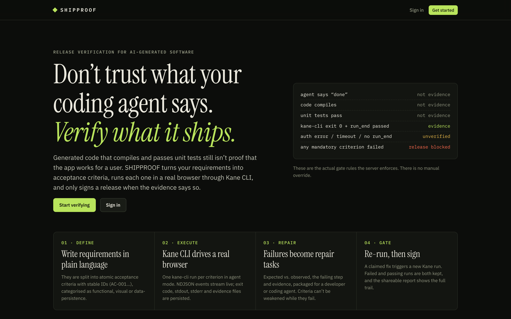
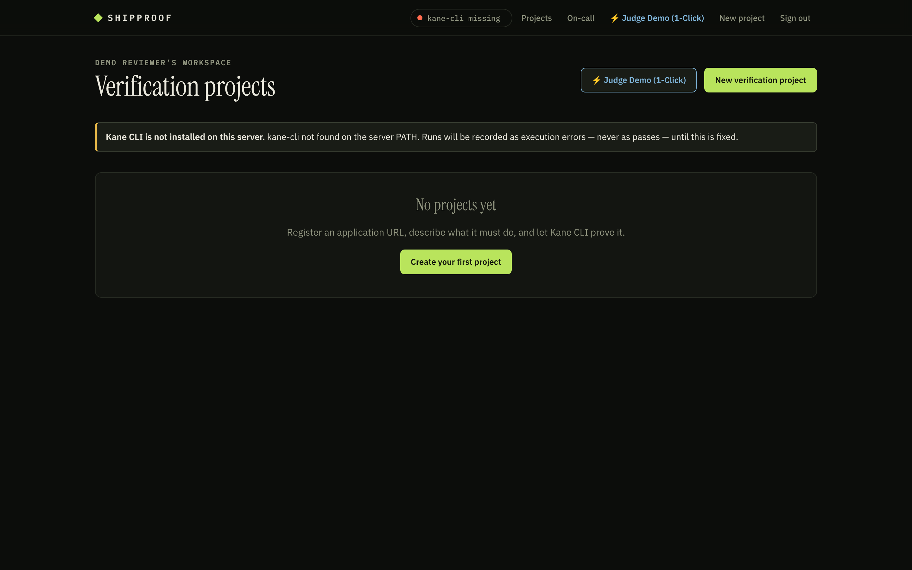
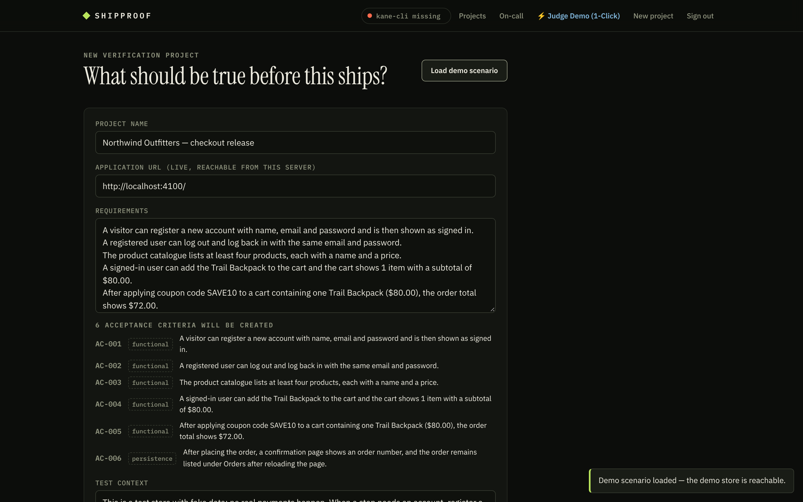
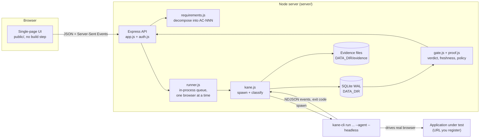
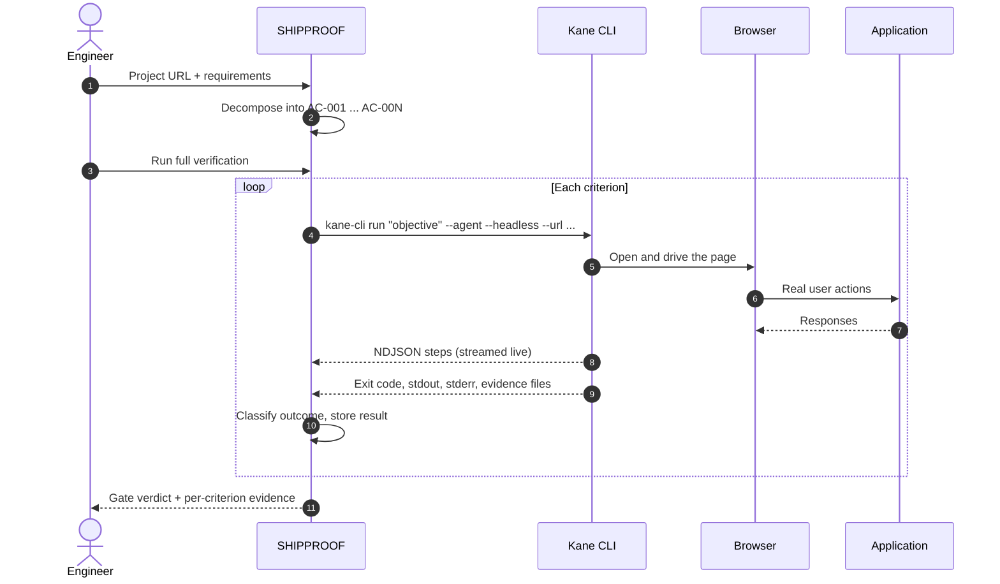
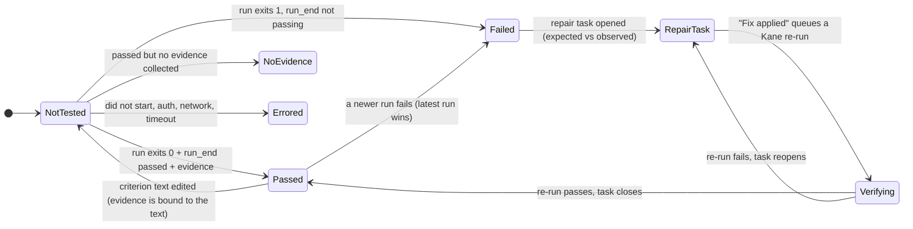
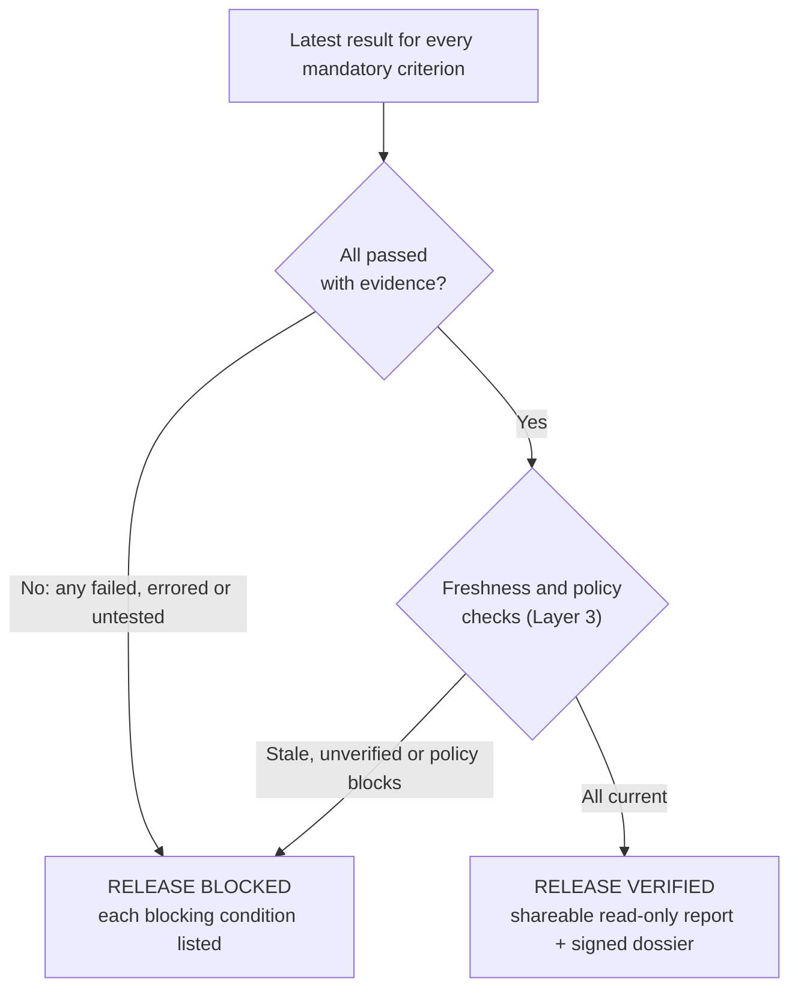
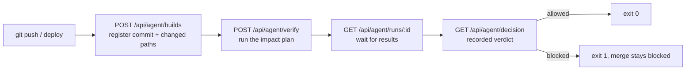

<div align="center">

# SHIPPROOF

**Don't trust what your coding agent says. Verify what it ships.**

Evidence-backed release verification for AI-generated software, powered by [Kane CLI](https://www.testmuai.com/docs/kane-cli-introduction).

[Quick start](#quick-start) · [How it works](#how-it-works) · [Gate rules](#gate-rules) · [Demo](#demo-walkthrough) · [API](#apis) · [Docs](#documentation)

</div>

---

SHIPPROOF takes a live application URL and requirements written in plain language. It splits the requirements
into atomic acceptance criteria, runs each one in a real browser through Kane CLI, stores what actually happened,
turns each failure into a repair task, re-verifies the fix, and only then signs the release.

The core rule is simple: **nothing in SHIPPROOF can mark a criterion as verified except a `kane-cli run` that
exits `0` with a passing `run_end` event.** There is no manual override.

## Contents

- [Screens](#screens)
- [How it works](#how-it-works)
- [Gate rules](#gate-rules)
- [Quick start](#quick-start)
- [Demo walkthrough](#demo-walkthrough)
- [Proof intelligence](#proof-intelligence)
- [On-call engineer (voice)](#on-call-engineer-voice)
- [APIs](#apis)
- [Tests](#tests)
- [Security](#security)
- [Documentation](#documentation)

## Screens

<table>
<tr>
<td width="50%" valign="top">

**Landing page.** The gate rules the server enforces, stated up front.



</td>
<td width="50%" valign="top">

**Workspace.** Projects, and a banner that states whether Kane CLI is installed and signed in.



</td>
</tr>
<tr>
<td width="50%" valign="top">

**Requirements to criteria.** Plain-language requirements become `AC-001`… with a type each, before anything runs.



</td>
<td width="50%" valign="top">

**Release gate.** A new project starts as **NOT VERIFIED**. Every criterion shows its status and evidence, and each has its own Run action.


</td>
</tr>
</table>

> The screenshots come from a fresh install on a machine without Kane CLI. The banner on the dashboard and
> project page says so, and runs are recorded as errors, never as passes. Screenshots of executed runs,
> evidence and the release report need Kane CLI signed in; see [Quick start](#quick-start).

## How it works

### Architecture



### One verification, end to end



### What happens to a failure



### Release decision



The gate is strict on purpose. A pass that was produced against an older version of a criterion, or
against a build whose changed files affect it, does not count.

### Why each part exists

| Part | Responsibility | Where |
|---|---|---|
| Requirement decomposition | Turns sentences into criteria with stable IDs, typed `functional`, `visual` or `persistence` | `server/requirements.js` |
| Kane runner | Spawns Kane CLI once per criterion, streams events, classifies the outcome | `server/kane.js`, `server/runner.js` |
| Gate | Computes criterion status and the release verdict from stored results on every request | `server/gate.js` |
| Proof engine | Criterion versions, build impact, freshness, stability, policy, signed dossiers | `server/proof.js` |
| Repair loop | Turns failures into prompts for a coding agent and re-runs only what was fixed | `server/app.js`, `server/coding-agent.js` |
| Continuous watch | Scheduled health checks of the verification system itself | `server/watch.js` |

Nothing on screen is stored as a status flag. Totals, criterion status and the verdict are recomputed from
the `results` table, so the UI cannot drift from the evidence.

## Gate rules

Enforced in `server/kane.js` and `server/gate.js`.

**What counts as a pass.** Exit code `0`, **and** a `run_end` event, **and** a passing status, **and** at least
one collected evidence artifact. Anything else is not a pass.

**What counts as no evidence.** Each of these is its own state, shown separately:

| Observation | Result |
|---|---|
| Kane CLI missing, not authenticated, or a network error | `error` (unverified) |
| Did not start, timed out, interrupted by a restart | `error` / `timeout` (unverified) |
| Exit code and `run_end` status disagree | `error / inconsistent` |
| Passing run with no evidence artifact | `error / no_evidence` |
| Target URL refused by the target policy | `error / target_blocked` |
| User cancelled | `cancelled`, ignored by the gate |

**Rules that follow from this:**

- The latest execution wins. A newer failure replaces an older pass.
- A failed mandatory criterion **blocks the release**.
- Evidence is bound to the criterion's text. Edit the text and the criterion returns to *not tested*.
- A criterion with an open failure cannot be reworded, made optional or archived.
- There is no "mark as passed" button.

## Quick start

**Requirements:** Node.js 22.5 or later, and Chrome or Chromium on the machine that runs the server.

```bash
npm install
```

```bash
npm install -g @testmuai/kane-cli
```

Sign in to Kane CLI once on the host. For servers and CI, skip this and set `LT_USERNAME` and `LT_ACCESS_KEY` instead (see below).

```bash
kane-cli login
```

```bash
cp .env.example .env
```

```bash
npm start
```

Open <http://localhost:4000>. The pill in the top bar shows the installed Kane CLI version and whether it is
signed in.

- The SQLite database and evidence files live in `DATA_DIR` (default `./data`).
- Migrations in `migrations/` run automatically on start. `npm run migrate` applies them on their own.
- For servers and CI, set `LT_USERNAME` and `LT_ACCESS_KEY` in the environment. They are passed to Kane CLI only
  and redacted from every stored log and API response.

### Docker

```bash
docker build -t shipproof .
```

```bash
docker run -p 4000:4000 -v shipproof-data:/data -e LT_USERNAME=... -e LT_ACCESS_KEY=... shipproof
```

Or with Compose (named volume, health check, graceful stop):

```bash
docker compose up -d --build
```

Deploy it anywhere that runs a long-lived container with Chrome: Fly.io, Render, Railway or a VM.
Serverless platforms are not suitable, because the engine spawns browser processes that run for minutes.
Production checklist, backup and restore, and rollback are in [docs/DEPLOYMENT.md](docs/DEPLOYMENT.md).

## Demo walkthrough

The repository ships a sample store, **Northwind Outfitters** (`demo-app/`): registration, login, product
catalogue, cart, coupon, checkout confirmation and order history. It has one real bug: coupon `SAVE10` is
accepted and the discount line is shown, but the order total does not change (`demo-app/pricing.js`). The
unit test for the discount maths passes anyway, which is exactly the gap SHIPPROOF is built to catch.

The demo store runs on `localhost`, so the server must allow private targets. `ALLOW_PRIVATE_TARGETS=1` is set in
`.env.example`; copy it to `.env`.

Terminal 1:

```bash
npm start
```

Terminal 2 (restarts automatically when the code changes):

```bash
npm run demo:app
```

| Time | Step |
|---|---|
| 0:00 | Sign up. The landing page states the gate rules. |
| 0:20 | **New verification project → Load demo scenario**. The URL and six requirements fill in and preview as `AC-001…AC-006`. |
| 0:40 | **Run full verification**. The live view streams Kane CLI's NDJSON steps as the browser registers, logs in, browses and adds to cart. |
| 1:20 | `AC-005` fails: the total shows $80.00 where $72.00 is expected. The gate reads **RELEASE BLOCKED**. Open the check for the failing step, screenshots, stdout, stderr and exit code. |
| 1:45 | **Failure analysis** → repair task `RT-1` with expected vs observed, evidence, and **Copy repair task** (a prompt for a coding agent). Editing `AC-005` is refused. |
| 2:05 | Apply the real fix: `npm run demo:fix`, a one-line patch to `pricing.js`. The store reloads. |
| 2:15 | **Fix applied → re-verify**. Kane CLI re-runs `AC-005` and it passes. `RT-1` closes and links to the passing run. |
| 2:35 | **Release report**: **RELEASE VERIFIED**, execution trail per criterion (red, then green for `AC-005`), both runs in history. Create a shareable link and open it signed out. |

Apply the fix and reset the store to the buggy build for another take:

```bash
npm run demo:fix
```

```bash
npm run demo:break
```

## Proof intelligence

SHIPPROOF tracks *which version* of the application each piece of evidence verified.

- **Proof graph.** Project → build → requirement → criterion version → execution → events → evidence →
  repair task → verifying run → release decision, as linked rows. Editing a criterion appends an immutable version,
  and each execution keeps pointing at the version it ran. Browse it in **Proof explorer**: search by key, text,
  area, path, commit SHA, run number or evidence hash.
- **Builds and change impact.** A build is a commit plus an environment, registered by CI, a GitHub push
  webhook or the UI. Each criterion can declare criticality, functional areas and source-path patterns
  (`**`, `*`, `?`). For a build, every criterion is reported as *affected*, *unaffected* or *unknown*, with a
  verification plan that gives a reason per criterion.
- **Freshness.** Evidence is `CURRENT`, `STALE`, `UNVERIFIED`, `FAILED` or `BLOCKED`. A pass goes stale when a
  later build changes mapped files, when impact cannot be established, or when environment, engine-version or
  policy rules say so.
- **Stability.** Classified from passed and failed outcomes of the current text only: `stable_pass`,
  `stable_fail`, `intermittent`, or `insufficient_data` below the minimum sample (default 5). Auth, network,
  timeout and interruption results are counted separately and excluded.
- **Risk.** An ordinal ranking built from listed factors (criticality, evidence state, stability, coverage gaps).
  It is not a probability and never changes a verdict.
- **Release policy.** Versioned per project. The decision is the strict gate **and** the policy. It lists each
  blocking condition with a code, the run it refers to, and the action that resolves it. No policy setting can
  make a failed or unexecuted mandatory criterion pass.
- **Proof dossier.** Canonical JSON with criterion versions, supporting executions, engine identity, evidence
  SHA-256 hashes, repair history and the decision, signed with a server-held Ed25519 key. Verify offline:

```bash
node scripts/verify-dossier.mjs shipproof-dossier-<id>.json --trust-key <keyId>
```

### GitHub CI

1. Project → **Settings** → generate an API key. Add it to the repository as the secret `SHIPPROOF_API_KEY`,
   and add the variable `SHIPPROOF_URL`.
2. Copy the workflow from Project → **CI** (served at `/ci/shipproof-verify.yml`) into `.github/workflows/`.
   Make it run after your deploy job.
3. Optional: Project → **CI** → create a webhook secret, then add a GitHub webhook (push events, JSON) so every
   push registers a build.

The job runs `/ci/shipproof-ci.mjs`: register the build, run the impact plan, wait for the run, fetch the
decision, and exit `0` only if the release is allowed.



## On-call engineer (voice)

Call an engineering agent from the browser and describe an incident. It investigates the systems it has access to,
fixes the defect on an isolated branch, proves the fix with a red/green regression test, pushes the branch and
opens a pull request. Every step is recorded as evidence, and production actions are gated on an on-screen
approval. Setup, the safety model and limits are in [docs/ONCALL.md](docs/ONCALL.md).

## APIs

Generate a project API key under **Settings → Coding-agent access**.

```
GET  /api/agent/repair-tasks                      open tasks, including a ready-to-use prompt
POST /api/agent/repair-tasks/:id/fix-applied      {"note":"..."} queues a Kane re-run
POST /api/agent/runs                              {"mode":"failed"} or {} for a full run
GET  /api/agent/gate                              verdict, reasons, per-criterion status
Authorization: Bearer spk_...
```

Proof and CI endpoints (Bearer project key):

| Endpoint | Purpose |
|---|---|
| `POST /api/agent/builds` | Register commit, environment and changed paths (idempotent) |
| `POST /api/agent/verify` | Run the plan (or `mode: "full"`) for a commit |
| `GET /api/agent/runs/:id` | Run status and per-criterion results |
| `GET /api/agent/decision?commitSha=` | Recorded release decision with blocking conditions |
| `POST /api/webhooks/github/:projectId` | GitHub push webhook (HMAC-SHA256, one-time delivery ids) |

Continuous watch (a scheduled health check of the verification system itself):

| Endpoint | Purpose |
|---|---|
| `GET/PUT /api/projects/:pid/watch` | Schedule (`enabled`, `intervalMinutes`), `autoRun`, per-project thresholds |
| `POST /api/projects/:pid/watch/check` | Run a check now |
| `GET /api/projects/:pid/watch/checks`, `/findings?status=`, `/trend` | History, finding ledger, variable series |

`autoRun` is off by default. A scheduled check only starts verification runs (which spend engine credits) when it is on.

## Tests

```bash
npm test
```

The suite runs with `node --test` and covers the unit logic (requirement decomposition, outcome classification,
gate), integration over a real HTTP server with SQLite and one child process per criterion, migration upgrades,
the target policy, the adapter contract, the proof engines, signed webhooks, the CI client, dossier tamper
detection, and browser end-to-end journeys (skipped when Playwright is absent).

**What is and is not real in the tests.** No test uses Kane CLI credentials. Two stand-in engines in
`tests/fixtures/` (`fake-kane.js` and `store-check-kane.js`) report a version containing `fixture`. The server
then labels the engine as *test stand-in*, tags those results "Test fixture", and warns on any report that
contains one. The product has no simulated mode and never falls back to a stand-in.

### Real Kane CLI smoke test

On a machine that is signed in to Kane CLI and can reach TestMu AI:

```bash
npm run kane:smoke -- https://example.com/ "The page shows the heading \"Example Domain\"."
```

It runs the same adapter as the server and prints the exit code, the `run_end` event, how SHIPPROOF classifies
the run, and which evidence files were collected.

## Security

- **Target policy.** Loopback and private application URLs are refused unless `ALLOW_PRIVATE_TARGETS=1`.
  Link-local and metadata addresses are always refused. The check runs again at run time.
- **Secrets at rest.** Public report links and agent API keys are stored as SHA-256 hashes, shown once, and
  revocable. Links can expire. Passwords use scrypt. Sessions use a random 256-bit token stored hashed, in an
  `HttpOnly`, `SameSite=Lax` cookie.
- **Isolation.** Every project, run, evidence and repair-task route checks ownership. Cross-tenant access returns
  404. Evidence files are addressed by random ids and served only to their owning account.
- **Audit.** Keys, links, runs, criterion edits and repair declarations are written to an append-only audit log.
- **Browser.** CSP without inline script. All user content is rendered as text nodes.
- **Kane credentials** come from the server environment only. Secret variables are write-only and redacted.
- **Residual risks.** The target policy checks the registered URL, not redirects or links the browser follows
  later, so run the container on a network segment without access to internal services. Sign-up is open, and
  rate limiting is in-memory per process. This project has had no external security review.

More detail: [docs/ARCHITECTURE.md](docs/ARCHITECTURE.md).

## Documentation

| Document | Covers |
|---|---|
| [docs/ARCHITECTURE.md](docs/ARCHITECTURE.md) | Components, data model, outcome classification, streaming, restart safety |
| [docs/DEPLOYMENT.md](docs/DEPLOYMENT.md) | Production checklist, backup and restore, rollback |
| [docs/ONCALL.md](docs/ONCALL.md) | Voice on-call engineer: setup, safety model, limits |
